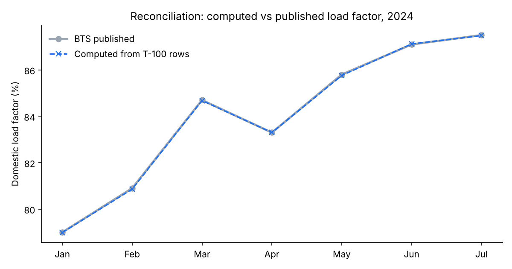
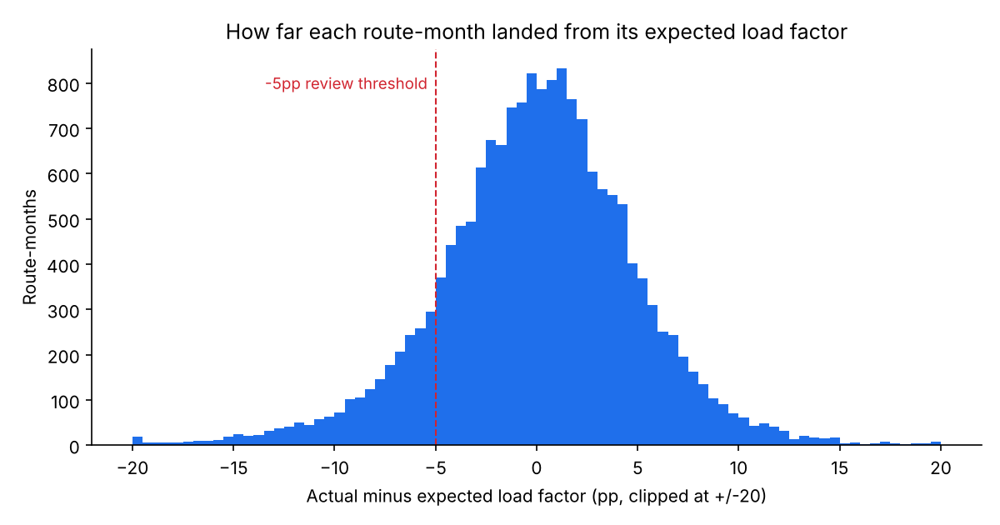
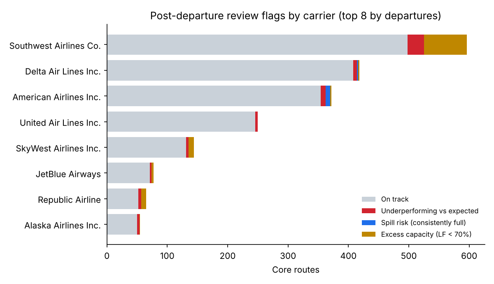
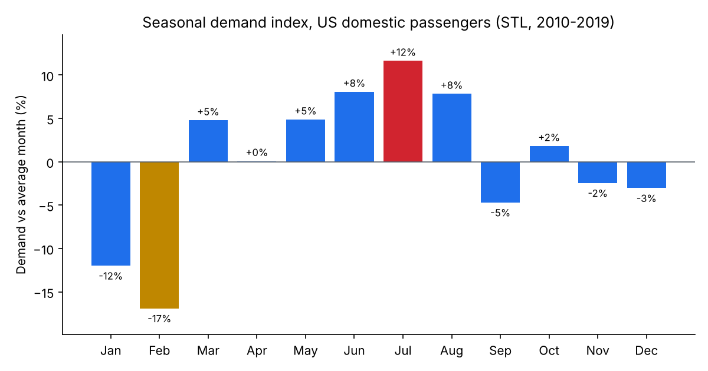
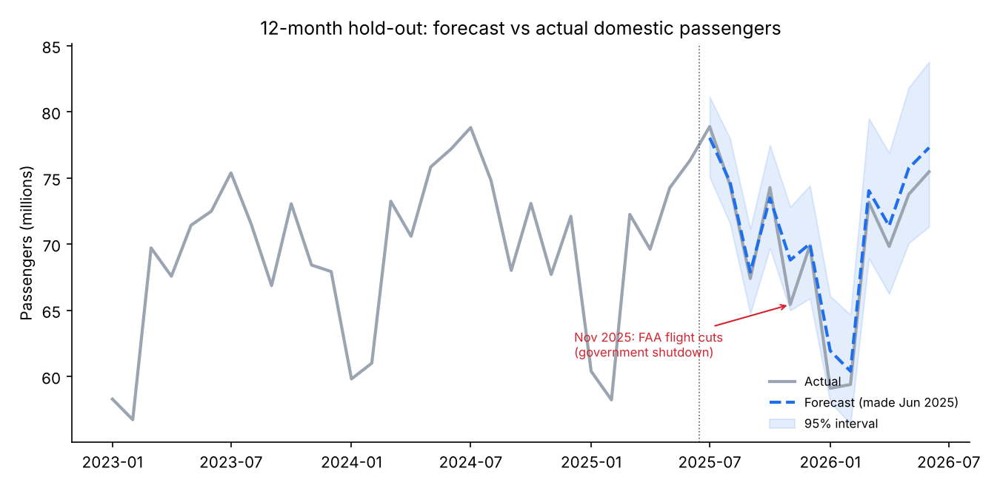
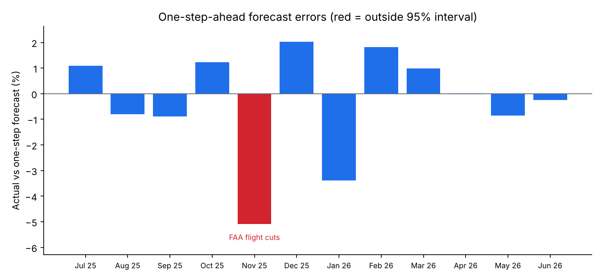

# Airline Post-Departure & Demand Analysis

A post-departure review of US domestic airline routes using public BTS T-100 Segment data (Jan–Jul 2024): reconcile the data against official figures, check its integrity, then compare each route's **actual** monthly load factor with what was **expected** and flag routes that need a revenue-management review.

A second part forecasts **network demand**: monthly US domestic passengers (Jan 2010 – Jun 2026) are decomposed into trend and seasonality, forecast with SARIMA and backtested on two hold-out years, and used to measure the effect of events on demand.

**Stack:** SQL (DuckDB) · Python (pandas, statsmodels, matplotlib)

## Key results

| | |
|---|---|
| Data | 314k T-100 segment rows → 196,535 rows in scope (US carriers, scheduled passenger service, domestic) |
| Reconciliation | Computed domestic load factor matches BTS's published figure within **0.04 pp in all 7 months** |
| Data-integrity checks | **11 checks**; 0 rows needed exclusion; 5 flag types investigated and explained (see below) |
| Post-departure review | **2,447 core routes** (35 carriers, 17,129 route-months, 58% of passengers in scope) |
| Flags | **80** underperforming vs expected · **10** spill risk (≥95% full in 3+ months) · **181** excess capacity (avg LF < 70%) |
| Demand forecast | SARIMA **1.2% MAPE** on a 2019 hold-out (seasonal naive 4.1%); **1.5%** one-step-ahead MAPE, Jul 2025 – Jun 2026 |
| Event effects | July peak **+12%** vs an average month, February **−17%**; Nov 2025 FAA flight cuts left demand **5.1% below forecast**, the only month outside the 95% interval |

### 1. Reconciliation against published figures

Before analysing routes, I rebuilt BTS's headline domestic load factor (revenue passenger-miles ÷ available seat-miles) from the raw segment rows and compared it with the published monthly series. Every month agrees within 0.04 percentage points, so the scope filters (carrier type, service class, aircraft configuration, domestic endpoints) match BTS's definition.



### 2. Data-integrity checks

| Check | Rows | Outcome |
|---|---:|---|
| Null keys, exact duplicates, passengers without seats, seats without departures, quarter/month mismatch | 0 | Clean |
| Inconsistent distance for the same airport pair | 0 | Clean |
| Passengers exceed seats (row LF > 100%) | 10 | Flagged; mostly 1–2 passengers over on single flights (likely non-revenue / jump-seat reporting) |
| Departures performed on an aircraft type with 0 scheduled | 13,886 | **Explained:** BTS reports one row per aircraft type, so equipment swaps look like unscheduled flights. Resolves when summed to route level |
| Route-months performing more departures than scheduled (after summing types) | 9,286 | Flagged; overall completion is still 99.5% |
| Implausible seats per departure | 321 | First version (< 9 seats) flagged 6,390 rows; review showed genuine 4–8 seat commuter aircraft (Alaska, Hawaii, Caribbean), so the floor was revised to < 2 |
| Origin equals destination | 1,655 | Flagged (sightseeing / return-to-origin); excluded from route analysis |

### 3. Post-departure review: actual vs expected

For every core route (flown all 7 months, ≥ 60 departures each month):

- **Expected LF** for a month = the route's own load factor in the *other* six months (leave-one-out, with seasonality removed) × the carrier's seasonal index for that month.
- **Variance** = actual − expected, in percentage points. Half of all route-months land within about ±3 pp of expected.



Routes are then flagged:

| Flag | Rule | Routes | Share of passengers |
|---|---|---:|---:|
| Underperforming vs expected | ≥ 5 pp below expected in 3+ months | 80 | 2.2% |
| Spill risk | LF ≥ 95% in 3+ months | 10 | 0.5% |
| Excess capacity | Average LF < 70% | 181 | 3.1% |
| On track | — | 2,176 | 94.2% |



**What stands out**
- **Spill risk is concentrated at American Airlines' Phoenix routes** (PHX–CLT, PHX–JFK, PHX–EWR, PHX–BOS, PHX–DCA), averaging 92–94% full. Consistently full flights suggest demand is being turned away, which points to higher fares in the top booking classes or bigger aircraft.
- **Southwest has the most excess-capacity routes**, including Hawaii inter-island flying (HNL–OGG at ~41% LF).
- **Ski and leisure routes show the limits of a carrier-level seasonal index:** SkyWest ASE–DEN fell 40 pp below expected in May, when the ski season ends. A route-level seasonal baseline (needs prior-year data) would fix this.

Full results: [`outputs/route_review.csv`](outputs/route_review.csv) and [`outputs/post_departure_route_months.csv`](outputs/post_departure_route_months.csv).

### 4. Demand forecasting and event effects

Route load factors say how full flights were; revenue management also needs to know **how many people will want to fly**. This part models monthly US domestic passengers (BTS enplanements, Jan 2010 – Jun 2026).

**Data checks and reconciliation.** The series has 198 months with no gaps, nulls or duplicates. It also ties back to part 1: for Jan–Jul 2024, BTS enplanements are within **0.4–0.8%** of the passengers summed from the T-100 segment rows (segment counts run slightly higher because they count each flight leg).

**Seasonality.** An STL decomposition of the clean pre-pandemic decade (2010–2019) gives the seasonal shape of demand: a summer peak (July **+12%** vs an average month), a winter trough (February **−17%**), and dips after the summer (September −5%) and around the holidays.



**Forecasting.** Models are fitted on the log of passengers. Pandemic months (Mar 2020 – Feb 2022) are treated as missing so they don't distort the model; SARIMA's Kalman filter bridges the gap. An Easter regressor captures whether the pre-Easter travel week falls in March or April. The final model order is chosen by AIC on the training window only.

| Hold-out | Seasonal naive | SARIMA airline model (0,1,1)(0,1,1)12 | SARIMAX (2,1,0)(0,1,1)12 + Easter |
|---|---:|---:|---:|
| 2019 (trained to Dec 2018) | 4.10% | 1.23% | **1.22%** |
| Jul 2025 – Jun 2026 (trained to Jun 2025) | **1.43%** | 1.90% | 1.96% |

*MAPE. Full forecasts with 95% intervals: [`outputs/demand_forecast_holdout.csv`](outputs/demand_forecast_holdout.csv).*

In 2019, demand kept growing and SARIMA beat "same month last year" by a wide margin. In 2025–26, demand flattened (2025 passengers were 1.3% below 2024) and SARIMA, which had learned the 2023–24 growth, over-forecast by about 1.6%. The seasonal-naive forecast happened to win in a flat year. The lesson for a revenue-management setting: a statistical forecast needs to be paired with live booking data and judgment when the trend turns.



**Event effects.** One-step-ahead forecasts (each made with only the data available the month before, parameters fixed from the training window) have a **1.5% MAPE** over the 12 hold-out months. Only one month falls outside the 95% interval:

| Event | Effect |
|---|---:|
| **Nov 2025: FAA-ordered flight cuts at 40 airports during the federal government shutdown** | actual **5.1% below** forecast; −3.3% year on year |
| Oct 2025 (shutdown under way, before the cuts) | +1.2% vs forecast; +1.6% year on year |
| Easter falling in March instead of April | +0.2% shift into March: no measurable effect at monthly level |

October was on track even though the shutdown had already started; the drop came in November when flights were cut, which points to a capacity constraint (cancelled flights) rather than travellers choosing not to fly. Easter timing barely moves monthly totals, likely because spring-break travel spans both months; it would need weekly or daily data to measure.



Outputs: [`demand_model_accuracy.csv`](outputs/demand_model_accuracy.csv), [`demand_one_step_forecasts.csv`](outputs/demand_one_step_forecasts.csv), [`demand_event_effects.csv`](outputs/demand_event_effects.csv), [`demand_seasonal_index.csv`](outputs/demand_seasonal_index.csv).

## How to run

```bash
pip install -r requirements.txt
# download the data first (see data/README.md)
python src/run_pipeline.py --raw data/raw/T_T100_SEGMENT_ALL_CARRIER.csv

# demand forecasting (needs only the committed reference data + the pipeline's reconciliation output)
python src/demand_forecast.py
```

The pipeline runs the four SQL files in order, writes CSVs and charts to `outputs/`, and **fails if the reconciliation drifts** beyond 0.1 pp of the published figure.

```
sql/01_staging.sql               scope the raw extract to BTS's domestic definition
sql/02_data_quality_checks.sql   11 integrity checks + clean table
sql/03_reconciliation.sql        computed vs published load factor
sql/04_post_departure_review.sql expected vs actual, route flags
src/run_pipeline.py              orchestration, exports, charts, assertions
src/demand_forecast.py           data checks, STL seasonality, SARIMA backtests, event effects
```

## Limitations

- **"Expected" is a statistical baseline, not an airline forecast.** Airlines compare against their own booking forecasts; public data has none.
- **Segment data has no fares**, so this measures load factor, not revenue or yield.
- **Seven months only**, so seasonality is estimated at carrier level; route-level seasonality (ski, spring break) needs prior-year data.
- US domestic market only; used as a public proxy for an airline network.
- **The demand forecast is network-level and monthly.** Airline RM forecasts by flight, fare class and days before departure from booking data; public data supports only the aggregate. Monthly totals also hide short events (Thanksgiving week, storms).
- BTS revises recent months; the enplanement figures are as published on FRED in Oct 2026.

## Data sources

- US DOT Bureau of Transportation Statistics, *T-100 Segment (All Carriers)*, Jan–Jul 2024, via TranStats.
- BTS published domestic load factor, scheduled passenger flights, not seasonally adjusted (FRED series `LOADFACTORD`).
- BTS enplanements, US air carrier domestic scheduled passenger flights, not seasonally adjusted, thousands (FRED series `ENPLANED`), Jan 2010 – Jun 2026.
